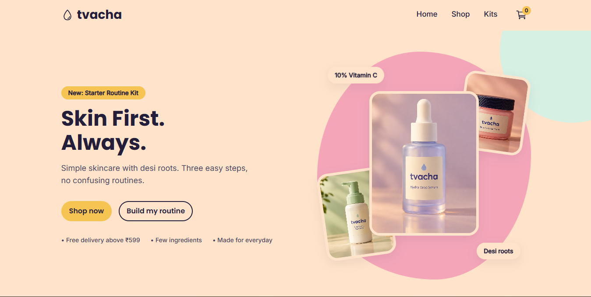

# Tvacha 🌿 | Skincare E-commerce Storefront
 
Tvacha is a modern, Gen Z-friendly skincare e-commerce website with an Indian touch, built with React. This is the **intermediate-level project** of my **ShadowFox Virtual Frontend Development Internship**.

🔗 *Live Demo:* https://tvacha-skincare-store-virid.vercel.app/
---

## 📸 Screenshots

 
---

## ✨ Features
 
- Responsive homepage with hero banner and featured products
- Product listing page with product cards 
- Individual product details page
- Add to cart, remove from cart and quantity update
- Cart total calculation
- Multi-page navigation using React Router
- Fully responsive on desktop, tablet and mobile
- Clean, consistent UI with a custom color palette and typography
 
---
 
## 🛠️ Tech Stack
 
- **React** (functional components + hooks)
- **React Router** for routing
- **CSS3** (custom styling, Flexbox, Grid, media queries)
- **JavaScript (ES6+)**
- **Vercel** for deployment
---

## 🎨 Design Decisions
 
- **Brand vibe:** Fresh, young and Indian-inspired, aimed at the new generation of skincare buyers.
- **Colors & fonts:** Planned in advance and used consistently across all pages.
- **Responsiveness:** Layout adapts for desktop, tablet and mobile using media queries.
- **Structure:** Reusable components keep the code clean and easy to maintain.
---
 
## 📚 What I Learned
 
- Building a multi-page React app with React Router
- Managing cart state across components
- Structuring reusable components for an e-commerce layout
- Making a layout responsive across screen sizes
- Deploying a React project and sharing a live link
---

## 🎓 About the Internship
 
This project was built as part of the **ShadowFox Virtual Frontend Development Internship** (Intermediate Level).
 
## 👩‍💻 Author
 
**Ashlesha Meshram**
 
- LinkedIn: [ashlesha-meshram2004](https://www.linkedin.com/in/ashlesha-meshram2004)
- GitHub: [ashleshameshram](https://github.com/ashleshameshram)
